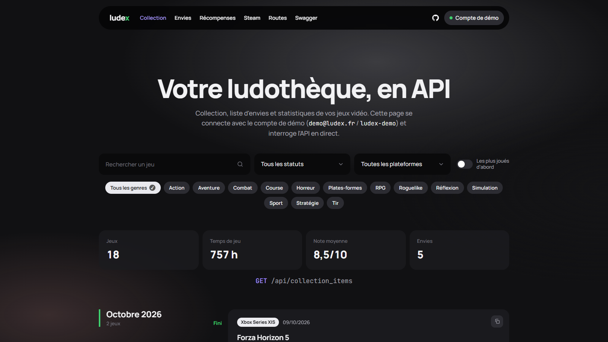

# Ludex · L'index de votre ludothèque, en API

> Jour 11 du défi **30 jours, 30 projets** · Symfony · API Platform · MySQL · ✅ **V1 en ligne** · 🚧 **V2 Steam codée**

Une **API REST** pour gérer sa collection de jeux vidéo : plateformes, état, temps de jeu, note, liste d'envies. **Ludex** est documentée (OpenAPI), sécurisée par jeton, et livrée avec une page de démo qui l'appelle en direct. Elle se branche sur Steam pour importer jeux, temps de jeu et succès, suivre les succès qui restent, décrocher des platines et débloquer des récompenses.

🔗 **https://ludex.projectp.fr** · Swagger : **https://ludex.projectp.fr/api/docs**

📄 Les règles détaillées sont dans le [cahier des charges](CAHIER_DES_CHARGES.md).



## Feuille de route

### V1 · l'API de collection (✅ en ligne)

- Catalogue commun en lecture libre : `Platform`, `Genre`, `Game` (54 jeux de démo).
- Par joueur : `CollectionItem` (statut : à faire, en cours, fini, abandonné ; temps de jeu ; note sur 10) et `WishlistItem` (priorité 1 à 3).
- CRUD complet, pagination de 20, filtres combinables (statut, plateforme, genre, titre) et tri.
- Inscription et connexion par jeton (JWT) ; chacun ne voit que sa collection (404 sur celle d'un autre).
- Statistiques : nombre de jeux, temps total, note moyenne, répartition par statut et par plateforme.
- Erreurs au format Problem Details, en français.
- Documentation interactive : Swagger sur `/api/docs`.
- Page de démo sur `/`, branchée sur le compte de démo.

### V2 · Steam (🚧 codée, à activer avec une clé Steam)

- **« Se connecter via Steam »** (OpenID) : Steam prouve le compte, sans partage de données à accepter. Un compte Steam ne se lie qu'à un compte Ludex.
- **Synchronisation** en tâche de fond (Symfony Messenger), une fois par heure au plus : jeux et temps de jeu dans la collection (plateforme PC), succès obtenus et rareté de chaque succès.
- Les jeux déjà au catalogue sont retrouvés par leur titre ; les autres y sont ajoutés avec leur image Steam.
- **Succès à faire** d'un jeu, des plus courants aux plus rares ; pourcentage par jeu.
- **Platines** : 100 % des succès d'un jeu, datées du dernier succès obtenu.
- **Récompenses** : 12 badges, cadres et titres débloqués par paliers (jeux, heures, succès, platines, succès rares).
- Profil privé ou « Détails des jeux » masqués : la réponse dit exactement quel réglage changer.

### V3 · autres plateformes (à étudier)

Xbox, PlayStation, RetroAchievements… seulement celles dont les données se récupèrent de façon fiable et autorisée.

## Les routes

| Méthode | Route | Accès |
| --- | --- | --- |
| `POST` | `/api/register` | libre (5 inscriptions par heure et par IP) |
| `POST` | `/api/auth` | libre (5 essais par minute) : renvoie `{"token"}` |
| `GET` | `/api/me`, `/api/stats`, `/api/rewards` | jeton |
| `GET` | `/api/games?title=&platform=&genre=&order[title]=`, `/api/platforms`, `/api/genres` | libre |
| `POST` `PATCH` `DELETE` | `/api/games`, `/api/platforms` | administrateur |
| `GET` `POST` | `/api/collection_items?status=&platform=&genre=&title=&exists[platinumAt]=true&order[playtimeMinutes]=desc` | jeton |
| `GET` `PATCH` `DELETE` | `/api/collection_items/{id}` | jeton, propriétaire |
| `GET` | `/api/collection_items/{id}/achievements?state=todo` | jeton, propriétaire |
| `GET` `POST` | `/api/wishlist_items?priority=&order[addedAt]=` | jeton |
| `GET` `PATCH` `DELETE` | `/api/wishlist_items/{id}` | jeton, propriétaire |
| `GET` `DELETE` | `/api/steam` | jeton : état de la liaison, ou déliaison |
| `POST` | `/api/steam/link` | jeton : renvoie l'adresse « Se connecter via Steam » |
| `POST` | `/api/steam/sync` | jeton : synchronisation (une par heure) |

Compte de démo : `demo@ludex.fr` / `ludex-demo`.

```bash
curl -s -X POST http://127.0.0.1:8000/api/auth -H 'Content-Type: application/json' \
     -d '{"email":"demo@ludex.fr","password":"ludex-demo"}'
curl -s 'http://127.0.0.1:8000/api/collection_items?status=finished&platform=ps5' -H "Authorization: Bearer $TOKEN"
```

### Lier son compte Steam

1. Rendre public son profil Steam **et** ses « Détails des jeux » (Steam > Profil > Modifier le profil > Confidentialité).
2. `POST /api/steam/link`, puis ouvrir `linkUrl` dans un navigateur et se connecter chez Steam : Ludex affiche « Compte Steam lié ».
3. `POST /api/steam/sync`, puis suivre `GET /api/steam` jusqu'à `"syncStatus": "ok"`.

## Lancer en local

PHP 8.4 avec les extensions `pdo_mysql` (ou `pdo_sqlite`), `intl`, `openssl` et `sodium`.

```bash
composer install
# .env.local (jamais versionné) : DATABASE_URL vers MySQL, ou SQLite pour essayer :
#   DATABASE_URL="sqlite:///%kernel.project_dir%/var/dev.db"
#   STEAM_API_KEY=…   (https://steamcommunity.com/dev/apikey)
php bin/console lexik:jwt:generate-keypair
php bin/console doctrine:database:create --if-not-exists
php bin/console doctrine:migrations:migrate      # MySQL ; avec SQLite : doctrine:schema:create
php bin/console doctrine:fixtures:load
symfony serve -d                                 # http://127.0.0.1:8000, Swagger sur /api/docs
php bin/console messenger:consume async -vv      # le worker des synchronisations Steam
```

Sous Windows, si la génération des clés échoue (`error:80000003`), indiquez à OpenSSL son fichier de configuration :
`OPENSSL_CONF=C:/php/extras/ssl/openssl.cnf`.

## Tests

```bash
php bin/phpunit
```

21 tests fonctionnels (ApiTestCase) sur une base SQLite recréée à chaque test :

- **API** : catalogue public, jeton obligatoire, isolation des collections, filtres combinés, validation et Problem Details, doublons, statistiques, inscription, droits d'administration.
- **Steam**, contre un faux Steam (`tests/Steam/FakeSteam.php`, aucun appel réel) : liaison OpenID, jeton d'état falsifié, compte déjà lié, synchronisation complète (jeux, succès à faire, platine, récompenses), limite d'une synchro par heure, profil privé, détails des jeux masqués, succès d'un autre joueur.

## Mise en ligne

Sur Coolify : **https://ludex.projectp.fr**, avec le `Dockerfile` (FrankenPHP) et une base MySQL 8.4.

Variables d'environnement :

| Variable | Valeur |
| --- | --- |
| `DATABASE_URL` | `mysql://…@…:3306/ludex?serverVersion=8.4.0&charset=utf8mb4` |
| `APP_SECRET` | une chaîne aléatoire (signe aussi le jeton d'état de la liaison Steam) |
| `JWT_PASSPHRASE` | une phrase secrète, qui chiffre les clés de signature |
| `STEAM_API_KEY` | la clé de la Steam Web API ; sans elle, la synchronisation répond 503 |

Au démarrage, le conteneur attend MySQL, joue les migrations, charge le catalogue et le compte de démo si la base est vide, crée les clés JWT s'il n'en a pas, puis lance le worker des synchronisations Steam à côté du serveur web.

## Stack

Symfony 8.1 · API Platform 5 · Doctrine ORM · Symfony Messenger · MySQL 8.4 · lexik/jwt-authentication-bundle · Steam Web API et OpenID · FrankenPHP.
